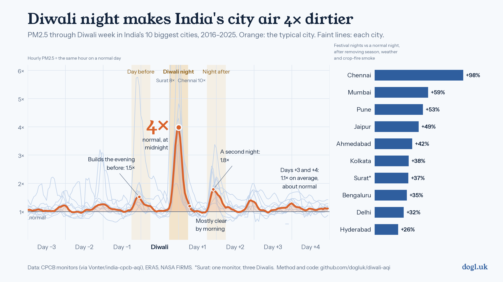

# Diwali and the air in India's biggest cities



How much does Diwali actually change the air, and how much of the famous "post-Diwali smog"
is Diwali at all? This repo answers both with ten years (2016–2025) of hourly government monitor
data for India's ten largest cities, and pulls apart the things that happen at the same time:
the start of winter smog season, crop-stubble smoke, and monsoon rain.

## What the data says

**The tempo of Diwali week** (median of the 10 cities; hourly PM2.5 ÷ the same hour on a normal day):

| | Day −2 | Day −1 | Diwali | Day +1 | Day +2 | Day +3 | Day +4 |
|---|---|---|---|---|---|---|---|
| Daily average | 1.1× | 1.2× | 1.5× | 1.8× | 1.3× | 1.1× | 1.1× |
| Night peak | 1.3× | 1.5× | **4.0× at midnight** | 1.8× | 1.4× | 1.3× | 1.1× |

Pollution builds the evening before, spikes to about **4× normal around midnight on Diwali night**,
is mostly gone by the next morning, comes back for a smaller second night, and is near normal from
day +3. (Day +1's daily average is the highest because the midnight smoke lands on it.)

**By city**, averaged over the three festival nights and adjusted for season, weather and crop fires:

| City | Diwalis | Naive before/after | **Adjusted** (95% CI) | Extra PM2.5 | Peak hour |
|---|---|---|---|---|---|
| Chennai | 10 | +113% | **+98%** (+45, +170) | +28 µg/m³ | 11.9× at 20:00 |
| Mumbai | 10 | +88% | **+59%** (+23, +105) | +29 | 4.0× at 00:00 |
| Pune | 8 | +51% | **+53%** (+36, +73) | +25 | 4.8× at 23:00 |
| Jaipur | 9 | +58% | **+49%** (+18, +87) | +32 | 4.6× at 00:00 |
| Ahmedabad | 7 | +55% | **+42%** (+9, +83) | +26 | 5.3× at 01:00 |
| Kolkata | 8 | +57% | **+38%** (−6, +101) | +25 | 3.8× at 00:00 |
| Surat* | 3 | +74% | **+37%** (−20, +136) | +24 | 11.0× at 00:00 |
| Bengaluru | 10 | +19% | **+35%** (+8, +70) | +10 | 3.9× at 22:00 |
| Delhi | 10 | +66% | **+32%** (+7, +64) | +49 | 3.9× at 00:00 |
| Hyderabad | 10 | +10% | **+26%** (+2, +55) | +12 | 2.1× at 23:00 |
| *Lucknow (extra)* | 10 | +43% | +36% (+15, +60) | +33 | 4.7× at 23:00 |

\*Surat has one monitor and three usable Diwalis. Ahmedabad is mostly one monitor before 2021.
The three-night average dilutes cities with one big night: Delhi's Diwali night on its own is
+80% (+42, +128).

1. **Every city has a real Diwali effect.** Fake "Diwalis" placed on other dates never come close
   (largest +36%). The signature is fireworks: in firework hours SO₂ (crackers are sulphur-based) rises
   1.25–2.3× in 9 of 11 cities while NO₂ and CO (traffic, smoke) rise far less than PM2.5.
2. **The "post-Diwali smog" is mostly not Diwali.** Naively, the week after looks 20–45% worse in
   Delhi, Kolkata, Lucknow, Jaipur and Hyderabad. Adjusted, it's between −6% and +7% everywhere, and
   no city's estimate is distinguishable from zero. It's the winter smog season starting.
3. **Confounding runs in opposite directions north and south.** In the north and east, Diwali falls
   as the smog season ramps up and stubble burning peaks, so a naive comparison *overstates* it
   (Delhi +66% → +32%). In the south, north-east monsoon rain washes the air, so a naive comparison
   *understates* it (Bengaluru +19% → +35%, Hyderabad +10% → +26%).
4. **Rain blunts Diwali.** Rain on the festival days goes with smaller spikes in 7 of 10 cities
   (Spearman −0.37 to −0.75). In Bengaluru, dry Diwalis ran 1.9–4.1× normal and rainy ones 0.8–1.6×.
5. **Chennai is the outlier:** the biggest relative spike (about 12× at the peak hour, from a clean
   baseline of ~29 µg/m³), and it starts at 8 pm, earlier than anywhere else. Delhi adds the most in
   absolute terms (about +49 µg/m³).
6. **Many cities have a second night**: Bengaluru (Bali Padyami), Ahmedabad (Gujarati New Year),
   Jaipur and Lucknow all spike again the night after.

## Data

All free, no API keys.

| What | Source | Licence |
|---|---|---|
| PM2.5, PM10, SO₂, NO₂, CO, O₃ every 15 minutes, ~500 stations | CPCB continuous monitors (CAAQMS), compiled by [Vonter/india-cpcb-aqi](https://github.com/Vonter/india-cpcb-aqi) | ODbL |
| Boundary-layer height, wind, rain, humidity, hourly | ERA5 reanalysis via the [Open-Meteo](https://open-meteo.com) archive API | CC BY 4.0 |
| Fire detections | [NASA FIRMS](https://firms.modaps.eosdis.nasa.gov) MODIS, India yearly archive | public |

## How the data was cleaned

1. **Timestamps are IST, not UTC.** The compiled parquets label CPCB's Indian wall-clock times as UTC
   without shifting them. Converting "UTC" to IST puts the ozone peak at 7 pm and the Diwali spike at
   4 am, both physically wrong. Read as-is, ozone peaks at 1–2 pm (it's made by sunlight) and NO₂ at
   the 7 pm rush hour. The code reads timestamps as IST.
2. **Instrument ceiling.** PM2.5 monitors max out at about 1,000 µg/m³. Delhi has hundreds of readings
   at the ceiling on Diwali night. These are kept as 999 when the rest of the city is also heavily
   polluted that hour (median of other stations ≥ 250), so Delhi's peaks are a *lower bound*. Otherwise
   a ceiling reading is treated as a fault.
3. **Stuck sensors.** Runs of eight or more identical 15-minute readings (two hours) are dropped.
4. **Impossible readings.** PM2.5 more than 10% above PM10 at the same moment is dropped, as are
   zero or negative values.
5. **Coverage.** A station counts for a year only if it reported PM2.5 for at least 60% of
   October–November. 2017 is thin almost everywhere.
6. **City series** = the median across a city's stations each hour, so one bad monitor can't drive it.

## How confounders were handled

Diwali moves around the calendar, from 19 October to 14 November, while the things that confound it
(smog season, stubble burning, the monsoon's end) follow the solar calendar. Comparing Diwali with the
same calendar dates in years when Diwali fell elsewhere separates "Diwali" from "early November".

- **Days run noon to noon**, so a firework night isn't split across two days.
- **Regression**, per city, 1 October – 10 December:
  `log PM2.5 ~ festival-day indicators + year + seasonal curve + weekday`
  `+ night boundary-layer height + wind + rain + humidity + fires`.
  - Fires = MODIS detections within 300 km over the previous three days, plus the Punjab–Haryana
    stubble belt for Delhi, Jaipur and Lucknow.
  - Two other firework nights in the comparison window, Dussehra (about 19 days before) and
    Gurpurab (15 days after), get their own indicators so they don't inflate "normal".
- **A three-night festival window.** The main cracker night differs by region: Naraka Chaturdashi
  in Tamil Nadu, Lakshmi Puja in the north, Kali Puja in Kolkata, Gujarati New Year and Bali Padyami
  the day after. So the headline is the average over day −1 to +1, with each night also estimated.
- **Honest uncertainty.** Errors are clustered by year with a t(G−1) critical value, so a city with
  three Diwalis gets a wide interval.
- **Naive vs adjusted.** "Naive" compares festival days with 8–21 days either side, on the same log
  scale as the regression.
- **Placebo.** The same model with fake Diwali dates (other years' dates, ≥ 10 days from the real
  one) gives medians between −5% and +1%, against +26% to +98% for the real dates.

The chart's hourly curve is descriptive: each hour ÷ the median of that clock hour on days 8–21 either
side, median year per city, then median across cities. The bars are the regression estimates.

## Caveats

- Ten Diwalis at most, and only 3–5 for some cities. Trust the pattern, not the second digit.
- MODIS misses small fires and fires lit after the satellite passes (reportedly more common since
  2023), so stubble smoke may be under-controlled in the north.
- ERA5 is a ~25 km grid, coarse for night-time mixing over a city.
- Station networks grew a lot over the decade (Bengaluru: 3 usable stations in 2016, 11 from 2023).
- Diwali 2026 (8 November) isn't in the source data yet.

## Reproduce

```bash
pip install -r requirements.txt
./download.sh            # ~4 GB: CPCB parquets + FIRMS CSVs
python extract.py        # -> data/hourly.parquet (cleaned, hourly, per station)
python pull_weather.py   # -> data/weather_era5.parquet
python fires.py          # -> data/fires_daily.parquet
python analyze.py        # -> data/nightday.parquet, effects.csv, summary.csv
python tempo.py          # -> data/tempo_hourly.csv, tempo_daily.csv
python chart_week.py     # -> charts/diwali_week.png + diwali_week_night.png (headline chart, two themes)
python charts_metros.py  # -> charts/chart_metros_summary.png, chart_metros_hourly.png
python charts.py         # -> Bengaluru vs Delhi deep-dive charts
python robustness.py     # hangover, rain and placebo checks for Bengaluru and Delhi
```

Cities, festival dates and fire regions are in `config.py`. The derived datasets in `data/` are
small enough to be included, so the analysis and chart steps run without the 4 GB download.

## More charts

- `charts/diwali_week_night.png`: the headline chart on a night-sky background
- `charts/chart_metros_summary.png`: naive vs adjusted, festival nights and the week after, per city
- `charts/chart_metros_hourly.png`: each city's hourly curve through Diwali
- `charts/chart_hero.png`, `chart_prepost.png`, `chart_confounders.png`: the Bengaluru vs Delhi
  deep dive (rain in Bengaluru, stubble smoke in Delhi)

## Licence

Code MIT; derived data ODbL (inherited from the CPCB compilation); fonts OFL. See `LICENSE`.
By [Akash Kulgod](https://dogl.uk).
