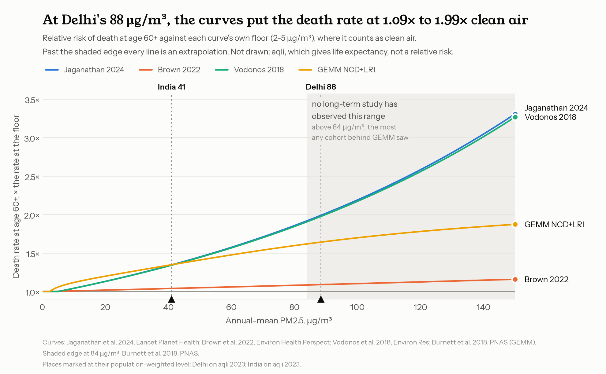
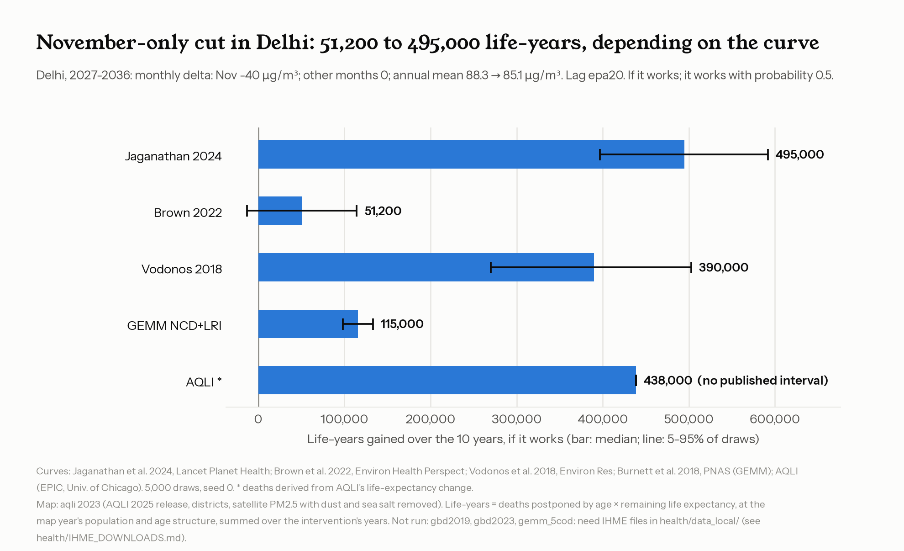

# airhealth: what cleaner air would buy India, and why the answers disagree

`airhealth` takes a change in the air an Indian place breathes and says how many deaths it
would postpone, how many years of life it would add, and how much those cost if the change
has a price. It runs from the terminal, and every number it prints names the assumptions it
rests on.

The published answers to "how many people does India's air kill?" differ several-fold. The
differences come from a few choices that are rarely shown side by side: which **risk curve**
turns pollution into deaths, which **exposure map** says how polluted each place is, and how
time and money are counted. This tool makes those choices visible instead of hiding them
inside one number.

The question it was built for: Delhi's air holds around 90 to 100 µg/m³ of fine particles
over a year (88 to 99 on the two satellite maps here, 94 to 105 at its monitors). What if
it went from 100 to 80?

```
$ airhealth compare Delhi --from 100 --to 80
Delhi (state): PM2.5 100 → 80 µg/m³
Population 21.5 M; all-cause deaths 99,445 a year (4.6 per 1,000). Steady state, per year.

curve                  PM2.5 µg/m³  % of deaths  deaths/yr  life exp. yrs  life-years/yr
--------------------  ------------  -----------  ---------  -------------  -------------
loglinear_jaganathan  100.0 → 80.0        15.2%     15,126          +2.25        313,040
loglinear_brown       100.0 → 80.0         1.9%      1,855          +0.24         33,078
loglinear_vodonos     100.0 → 80.0        13.8%     13,744          +1.97        228,660
gemm_ncd_lri          100.0 → 80.0         4.1%      4,031          +0.53         67,116
aqli *                100.0 → 80.0        13.4%     13,330          +1.96        275,871
...
```

Same place (the state of Delhi), same change, same population and death rates: between
1,900 and 15,000 deaths a year, and between a quarter of a year and two and a quarter years
of life expectancy, depending only on the curve. No study has followed people who breathe
air this dirty for years, so every curve is being stretched past its evidence here; the tool
shows how far apart the stretches land rather than picking one.

**A few terms, defined once.**
**PM2.5** is the mass of fine particles (smaller than 2.5 thousandths of a millimetre) in a
cubic metre of air, in micrograms (**µg/m³**). Every number here is an **annual mean**: the
average over a whole year, which is what the long-term studies measure. A
**population-weighted** mean counts each district by how many people live in it.
A **risk curve** says how much the death rate rises at a given PM2.5 level, as a **relative
risk** (1.15 means 15% more deaths than in clean air). Each curve has a **floor**, the level
below which it assumes no further benefit (2 to 5 µg/m³ here). An **exposure map** gives
PM2.5 and population for each district, state or city. **Steady state** means the effect
once the new air has been breathed long enough for the full benefit, at today's population
and age structure. **Life expectancy** is the average age at death if today's death rates
held for a lifetime. **Life-years** are the extra years lived: here, each death postponed
times the years a person of that age would still expect to live. The **crude death rate** is
deaths in a year per 1,000 people. The **SRS** (Sample Registration System) is the
government survey that measures India's death rates.

## Install

```
cd air-apocalypse
python3 -m venv .venv
.venv/bin/pip install -e "health[dev]"
cd health
../.venv/bin/python -m pytest -q
../.venv/bin/airhealth --help
```

Python 3.11 or newer. Everything the commands need is committed under `data/`, with its
source, page and method in `data/sources.toml`. A value that could not be confirmed at its
source is left out and listed in `data/MISSING.md`. The few sourced numbers that live in
code instead of a data file (AQLI's 0.98, GEMM's 2.4, the lag shares and so on) are listed
with their sources by `airhealth.provenance.constants()`, and the tests check both.

## The commands

Add `--json` to any command for the same content as JSON, and `--debug` to see the full
traceback of an error instead of one line. Every table ends with one line naming the
exposure map and its year, how the death counts were scaled (see "How many deaths a year"
below), a city's population year where a city is used, the states that had to borrow
all-India death rates, and the curves that could not run, with why.

### `list`: what the tool knows, each with its source

```
$ airhealth list curves
loglinear_jaganathan  [yes]
  Log-linear, Jaganathan 2024 (Indian districts, all-cause, all ages)
  Source: Jaganathan S, Stafoggia M, Rajiva A, et al. Estimating the effect of annual PM2.5 exposure on mortality in India: a difference-in-differences approach. Lancet Planet Health 2024; 8: e987-96. doi:10.1016/S2542-5196(24)00248-1. https://pmc.ncbi.nlm.nih.gov/articles/PMC11790315/

loglinear_brown  [yes]
  Log-linear, Brown 2022 Million Death Study (non-accidental; studied at ages 15-69, applied from 15, extrapolated above 69)
  Source: Brown PE, Izawa Y, Balakrishnan K, et al. Mortality associated with ambient PM2.5 exposure in India: results from the Million Death Study. Environ Health Perspect 2022; 130(9): 097004. doi:10.1289/EHP9538. https://pmc.ncbi.nlm.nih.gov/articles/PMC9472672/
...
```

`list maps` and `list places` work the same way; `list maps` says which years can give
results (the population projections start in 2011). Places are India, its states and union
territories, its districts, and eleven cities; any common spelling is accepted ("Orissa",
"NCT of Delhi"), and a misspelling gets suggestions.

### `compare`: one place, one change, every curve

Shown above. `--from` sets the starting level for every district (the map then supplies
only the population); without it, the start is the map's own level for the place, and
`--to` is the new level. A row marked † moves below its curve's floor, where that curve
counts no further benefit.

### `burden`: how many deaths the air above clean causes now

```
$ airhealth burden India
India (country): deaths attributable to PM2.5 above each curve's own floor
Population 1,390.3 M; all-cause deaths 9,365,121 a year (6.7 per 1,000). Steady state, per year.

curve                 PM2.5 µg/m³  % of deaths  deaths/yr  life exp. yrs  life-years/yr
--------------------  -----------  -----------  ---------  -------------  -------------
loglinear_jaganathan   41.2 → 5.0        24.9%  2,330,389          +4.57     52,713,269
loglinear_brown        41.2 → 2.0         3.4%    317,303          +0.49      5,569,111
loglinear_vodonos      41.2 → 5.0        21.5%  2,011,725          +3.71     32,923,807
gemm_ncd_lri           41.2 → 2.4        16.4%  1,531,856          +2.59     24,997,970
aqli *                 41.2 → 5.0        20.1%  1,884,073          +3.55     42,487,031

  loglinear_jaganathan: Log-linear, Jaganathan 2024 (Indian districts, all-cause, all ages)
  loglinear_brown: Log-linear, Brown 2022 Million Death Study (non-accidental; studied at ages 15-69, applied from 15, extrapolated above 69)
  loglinear_vodonos: Log-linear, Vodonos 2018 meta-regression (all-age all-cause in the paper, applied from age 25: the pooled studies are adult cohorts), slope at a study mean of 30 µg/m³ (the published slope falls with concentration; one slope misstates it)
  gemm_ncd_lri: GEMM NCD+LRI (Burnett 2018), age-specific
  aqli: AQLI linear, 0.98 years of life expectancy per 10 µg/m³
  * deaths derived from the life-expectancy change, not a relative risk

Map: aqli 2023 (AQLI 2025 release, districts, satellite PM2.5 with dust and sea salt removed). Deaths scaled to each state's SRS crude death rate, 2020-24: ×0.87 overall, ×0.57 to ×0.95 by state (data/death_reconciliation.csv); life expectancy is from the unscaled life tables. All-India death rates used for Andaman & Nicobar Islands, Arunachal Pradesh, Chandigarh, Dadra & Nagar Haveli, Daman & Diu, Goa, Ladakh, Lakshadweep, Manipur, Meghalaya, Mizoram, Nagaland, Puducherry, Sikkim, Tripura (no SRS life table). Not run: gbd2019, gbd2023, gemm_5cod: need IHME files in health/data_local/ (see health/IHME_DOWNLOADS.md).
```

AQLI gives a change in life expectancy, not a relative risk. To put it in the same table,
the tool finds the single multiplier on death rates that produces AQLI's change and reports
the deaths that implies; the star marks those as derived. This is the command the
benchmarks below use. `--counterfactual C` measures against C µg/m³ instead of each curve's
floor.

### `chart`: the curves, with places marked

```
$ airhealth chart Delhi India
/Users/ask/git/gitcat/indian_health/air-apocalypse/health/charts/curves_delhi.png
```



The shaded band starts at 84 µg/m³, the highest long-term exposure in any group of people
behind the GEMM curve. Everything to its right is extrapolation.

### `dashboard`: a local page over the same numbers

```
airhealth dashboard            # opens http://127.0.0.1:8765/ ; Ctrl-C to stop
```

One page, served only to this machine, with a place picker, the exposure map, the death-count
basis and From/To sliders. It shows what the change buys on every curve, the burden at the
map's level, the curve shapes, how the three state-level maps disagree, and a table of every
input the result depends on with which of them can be switched today. It calls the same
functions as `compare` and `burden`, so the numbers match the terminal (`tests/test_dashboard.py`
checks this). It always uses each map's latest year.

### `run`: an intervention, with odds, cost and uncertainty

An intervention is a short text file (next section). `run` draws 5,000 versions of it: each
draw takes one value of the PM2.5 change (when the file gives a range), one set of curve
parameters from the published uncertainty, and one value of each cost. This is a **Monte
Carlo** simulation; the **5-95% range** is the span holding the middle 90% of draws. Which
curve and which map are never drawn: each curve is its own row, and a run uses one map.

```
$ airhealth run interventions/november_only_delhi.toml
November-only cut in Delhi
Delhi (state). 2027-2036: 10 years, no ramp, lag epa20; these deliver 7.0 years of the full effect. Probability it works: 50%.
Change: monthly delta: Nov -40 µg/m³; other months 0; annual-mean change -3.29 µg/m³ (PM2.5 88.3 → 85.1, population-weighted; median draw).
Population 21.5 M; all-cause deaths 99,445 a year (4.6 per 1,000). 5,000 draws, seed 0.

If it works, totals over the run (median, 5-95% range):
curve                                      life-years                deaths postponed  life exp. at full effect, yrs
--------------------  -------------------------------  ------------------------------  -----------------------------
loglinear_jaganathan     383,000 (308,000 to 459,000)       18,500 (14,900 to 22,200)         +0.36 (+0.29 to +0.44)
loglinear_brown             37,800 (-9,340 to 84,400)           2,120 (-524 to 4,730)         +0.04 (-0.01 to +0.09)
loglinear_vodonos        281,000 (195,000 to 363,000)       16,900 (11,800 to 21,800)         +0.32 (+0.22 to +0.41)
gemm_ncd_lri                82,000 (69,600 to 94,600)          4,920 (4,180 to 5,670)         +0.09 (+0.08 to +0.11)
aqli *                340,000 (no published interval)  16,400 (no published interval)  +0.32 (no published interval)

Expected = mean if it works × probability it works (0.5). Cost if it works: $18.2 M ($5.78 M to $61.6 M), 2025 prices, ₹87.16 per $ (World Bank 2025 average), no inflation adjustment; all of it spent whether or not it works.
curve                 expected life-years  cost per life-year if it works  expected cost per expected life-year
--------------------  -------------------  ------------------------------  ------------------------------------
loglinear_jaganathan              192,000                           $61.7                                  $123
loglinear_brown                    18,900                            $624                                $1,250
loglinear_vodonos                 140,000                           $84.5                                  $169
gemm_ncd_lri                       41,000                            $288                                  $577
aqli *                            170,000                           $69.7                                  $139
  (costs per life-year are ratios of means over the draws)

What drives the spread in life-years within each curve (share of variance, each part sampled alone):
curve                 PM2.5 change       curve parameters
--------------------  ------------  ---------------------
loglinear_jaganathan            0%                   100%
loglinear_brown                 0%                   100%
loglinear_vodonos               0%                   100%
gemm_ncd_lri                    0%                   100%
aqli *                          0%  no published interval
Across curves, the largest median life-years is 10.1× the smallest.

  loglinear_jaganathan: Log-linear, Jaganathan 2024 (Indian districts, all-cause, all ages)
  loglinear_brown: Log-linear, Brown 2022 Million Death Study (non-accidental; studied at ages 15-69, applied from 15, extrapolated above 69)
  loglinear_vodonos: Log-linear, Vodonos 2018 meta-regression (all-age all-cause in the paper, applied from age 25: the pooled studies are adult cohorts), slope at a study mean of 30 µg/m³ (the published slope falls with concentration; one slope misstates it)
  gemm_ncd_lri: GEMM NCD+LRI (Burnett 2018), age-specific
  aqli: AQLI linear, 0.98 years of life expectancy per 10 µg/m³
  * deaths derived from the life-expectancy change, not a relative risk

Map: aqli 2023 (AQLI 2025 release, districts, satellite PM2.5 with dust and sea salt removed). Life-years = deaths postponed by age × remaining life expectancy at the age of death, at the map year's population and age structure, summed over the intervention's years. Deaths at ages 45 and over scaled by ×0.72 to the SRS crude death rate for Delhi, 2020-24 (4.5 per 1,000); life expectancy is from the unscaled life table. Not run: gbd2019, gbd2023, gemm_5cod: need IHME files in health/data_local/ (see health/IHME_DOWNLOADS.md).
```

How to read it:

- **A November-only cut is small on the annual mean.** Forty µg/m³ off November alone is
  40 × 30/365 = 3.3 µg/m³ off the year, and long-term health follows the year. The sky
  changes a lot for a month; the death rate barely moves.
- **"If it works" and "expected" are kept apart.** The first table assumes the intervention
  succeeds. The probability of success is never drawn at random; it multiplies the mean to
  give the expected life-years.
- **Two cost figures.** *Cost per life-year if it works* is mean cost over mean life-years,
  given success. *Expected cost per expected life-year* charges the cost that is spent
  whether or not it works against the life-years you can expect. By default the whole cost
  is spent either way, so the second is the first divided by the probability. Rupees become
  dollars at the World Bank's annual average rate for the file's price year
  (`data/fx_inr_usd.csv`, 2000-2025). There is **no inflation adjustment**: a 2015-price
  file is reported in 2015 dollars.
- **What drives the spread.** Each part is sampled alone with the other held at its median,
  and its share of the variance is shown. In this file the PM2.5 change is a fixed number,
  so all of the spread within a curve comes from the curve's own published uncertainty.
  AQLI publishes no interval for its coefficient, so its row has one value and says "no
  published interval": that is a gap in the evidence, not certainty. (If a file gives the
  PM2.5 change as a range, AQLI's row gets a range marked "PM2.5 change only".)
- **Brown's range crosses zero, on purpose.** Brown 2022's interval reaches a relative risk
  of 1.00. Each curve's slope is drawn from its published interval on the scale it was
  estimated on (the log of the relative risk) and is not cut off at zero, so about one
  Brown draw in eleven has a negative slope: in those draws cleaner air raises deaths, and
  they are the negative end of Brown's range above. They are kept because dropping them
  would push Brown's average above what the paper found. Read the range as "this study
  cannot rule out no effect", not as evidence that cleaner air does harm.
- **Across curves** the medians differ tenfold, far more than any curve's own range.

`--charts DIR` also draws two charts:




Other flags: `--map M` (default: cpcb when every place is a city with ground monitors,
otherwise aqli), `--curves a,b`, `--n N` draws, `--seed S` (the same seed gives the same
answer), `--deaths srs|model` (next section but one).

**How time is counted in this version.** The steady-state effect is computed once per
draw. Each year of the intervention then realises a share of it. The **ramp** brings the
change in over `ramp_years` in equal steps. The **cessation lag** is how slowly the death
rate follows the air down: by default the US EPA's 20-year lag (30% of the fall in risk in
the first year, 50% spread over years 2-5, 20% over years 6-20); `immediate` puts it all in
year one. Each step of the ramp starts its own lag clock. Deaths postponed and life-years
are the steady-state figures times the sum of those yearly shares. Years after the
intervention ends count for nothing, and nothing is discounted. Life-years are deaths
postponed × remaining life expectancy at the age of death. People who die in a five-year
age band die on average half-way through it, so each death is credited with the life
expectancy of a person alive at that point (in infancy, at the life table's own average age
of infant death), worked out from the life table's own person-years; the open band of 85
and over uses life expectancy at 85. Taking life expectancy at the start of the band
instead, as an earlier version did, overstates life-years by about 7%. A year-by-year cohort
run to 2050, with the population ageing, replaces this accounting in the next version.

## Writing an intervention file

Copy `interventions/_template.toml`; every field is explained there. A mistake is reported
in one line naming the field, for example `airhealth: p_success: must be between 0 and 1,
got 2`. The shape:

```toml
name = "10% cut in Punjab and Haryana"
places = ["Punjab", "Haryana"]   # India, states, districts or cities; overlaps are refused
start_year = 2027
ramp_years = 3                   # years to reach the full change
duration_years = 15
p_success = 0.3                  # probability it works at all
lag = "epa20"                    # or "immediate"
# from_level = 100               # what-if: start every district at this level

[change]                         # exactly one of these
pct = -10                        # delta = -20 | pct = -10 | to = 40 |
                                 # monthly_delta = [12 values] | monthly_pct = [12 values]

[cost]
once = { dist = "lognormal", p5 = 5e9, p95 = 5e10 }
annual = { dist = "lognormal", p5 = 1e9, p95 = 1e10 }
currency = "INR"                 # or "USD"
year = 2025                      # price year; rupees converted at that year's average rate
share_only_on_success = 0.0      # share of the cost spent only if it works
```

Any number in `[change]` or `[cost]` can be a range instead: give its 5th and 95th
percentiles and a shape, `normal`, `lognormal` (skewed, never crossing zero), `uniform`, or
`triangular` (with a `mode`). Twelve monthly values are averaged by days in the month; when
they are ranges they are drawn together, so a draw that is good for November is good for
December too. A drawn change never takes the air below 0 µg/m³. `monthly_pct` takes every
month to be as polluted as the annual mean, which understates a winter-only cut where
winters are dirtier than the rest of the year; a run that uses it says so.

The three examples: `delhi_100_to_80.toml` (the what-if above, no cost or odds),
`november_only_delhi.toml`, and `punjab_haryana_10pct.toml`. Their odds and costs are
illustrative placeholders, said so in each file's notes, and should not be quoted.

## The exposure maps, and how much they disagree

Where a place starts on the curve matters as much as the curve, and the maps disagree
twofold. Population-weighted annual-mean PM2.5 in µg/m³, from this tool:

| Place | `aqli` 2023 | `aqli` 2019 | `acag_total` 2023 | `gbd2019` 2019 |
|---|---:|---:|---:|---:|
| India | 41.2 | 44.6 | 49.8 | 90.9 |
| Delhi | 88.3 | 92.7 | 98.8 | 217.6 |
| Uttar Pradesh | 56.2 | 64.8 | 68.2 | 182.9 |
| Bihar | 60.1 | 68.6 | 64.0 | 167.8 |
| Kerala | 18.5 | 17.1 | 26.1 | 15.8 |

Delhi's own ground monitors (`cpcb`, the city, mean of hourly medians across stations): 104.7
in 2019, 97.5 in 2023, 94.3 in 2025.

- `aqli`: the Air Quality Life Index's district table, from satellites, with dust and sea
  salt removed (the index counts only the pollution people make).
- `acag_total`: the same satellite family (Washington University's ACAG V6) with dust kept,
  averaged to districts by this repo.
- `gbd2019`: the Global Burden of Disease 2019 state values, as printed in Pandey et al. 2021
  (a model fusing satellites, chemistry models and monitors). One value per state.
- `cpcb`: the Central Pollution Control Board's monitors, for eleven cities only.

Keeping dust moves India from 41 to 50: dust explains under a fifth of the gap to GBD's 91.
The rest is concentrated in the northern plain (Uttar Pradesh 56 against 183); in Kerala
the three maps land within 16 to 26. In Delhi the monitors side with the satellites, not with GBD 2019. Why GBD
2019 sits so high is an open question; see G7 in [`../lit/gaps.md`](../lit/gaps.md).

## How many deaths a year? The count is tied to the SRS

Deaths, life-years and cost per life-year all scale with one number: how many people die in
a place each year. The tool takes death rates by age from the SRS life tables for 2020-24
and the number of people at each age from the official population projections. Multiplied
together they give India 7.5 deaths per 1,000 people (2022 population). The SRS's own
published crude death rate for the same five years averages 6.6. For Delhi it is 5.9
against 4.5. An earlier version of this tool printed the higher counts.

**Where the gap is.** It was traced with the SRS's own tables for 2020 to 2024
(`data/srs_*.csv`, each read at the source; `tests/test_baseline.py` repeats the check):

- **Not in the death rates.** The life-table rates are the SRS's age-specific death rates
  for the same years, within 2% at ages 30 to 79. Put on the SRS's own age distribution
  they give back its crude death rate: 6.63 for India.
- **Not in the period.** Both sides are 2020-24, the pandemic year 2021 included (the SRS
  crude rate was 6.0, 7.5, 6.8, 6.4 and 6.4 in the five years).
- **In the age structure.** The projections, made in 2019 from the 2011 Census, have more
  older people than the SRS finds in its sample: 10.5% of Indians are 60 or over in the
  projection for 2022, 9.1% in the SRS's 2020-24 reports. The same holds in every one of the
  22 states with a life table, and all of the excess deaths are at 45 and over; under 45 the
  two agree within 0.1 per 1,000. Delhi's gap is the largest because its age gap is: 9.7%
  aged 60 or over in the projection, 7.2% in the SRS.
- **A little in the oldest band.** The life table closes the 85-and-over band by a model,
  so its rate there differs from the SRS's (India 153 against 148 per 1,000; Delhi 145
  against 123; Kerala 148 against 176), and the tool splits the projection's 80+ group
  between 80-84 and 85+ by the life table, not by the SRS's own split. Together these move
  India's deaths by about 1%.

**What the tool does about it.** By default (`--deaths srs`) each state's death count is
scaled to that state's own mean SRS crude death rate for 2020-24. For India and the 22
states with their own life table the factor applies to deaths at 45 and over, where the
excess is (India ×0.85, Delhi ×0.72, Telangana ×0.73 at one end, Himachal Pradesh ×0.95 at
the other). For the 15 small states and territories that borrow all-India death rates, one
factor applies at every age and brings the borrowed rates to the state's own SRS rate
(Chandigarh ×0.57 to Goa ×0.94). Every state and territory has its own SRS rate; Dadra &
Nagar Haveli and Daman & Diu share the rate of the union territory they were merged into.
The factors are in `data/death_reconciliation.csv`, built by
`scripts/build_death_reconciliation.py`, and the last line of every result names the factor
used. **Life expectancy is never scaled:** it comes from the life table as published, which
this tool reproduces to within 0.09 years. `--deaths model` (or `deaths="model"` in Python)
switches the scaling off and gives projected population × life-table rates.

The factor is measured at the 2022 population and used in every year from 2020 on. In a
later year the count drifts above the SRS rate as the projected population ages (Delhi 2023:
4.6 per 1,000); after 2024 nothing checks it, and every result says so.

**Years before 2020** use that year's own SRS reports (2011-19, transcribed). Mortality then
was higher mostly among young children (India 2011: death rates under 5 were 1.75 to 2.8
times 2020-24's, ages 30-70 about the same) and at 80 and over, so a single factor would put
the extra deaths at the wrong ages. Instead each age band's rate is the 2020-24 rate times
the SRS's rate for that band in the year and a year either side, over its 2020-24 mean (the
state's own, or India's where the state has none: the smaller states, and Telangana and
Uttarakhand before 2014). Life expectancy moves with these rates. The counts are then scaled
at 45 and over to the SRS's crude death rate for that year
(`data/death_reconciliation_by_year.csv`). India's factor is 1.02 in 2011 and falls to 0.78
by 2019: with the year's own rates by age, the only gap left is the projection's age
structure drifting away from the SRS's as it moves on from the 2011 Census. States the SRS
printed no rate for before 2020 (the smaller states and UTs) keep the 2020-24 factor, and
the footer says which. Andhra Pradesh before 2014 is the undivided state in the SRS.

**Which count is right is not settled.** The evidence both ways:

- *For the SRS rate.* It is the official estimate, from the same survey as the death rates,
  and a tool should not report more deaths than the source it takes its rates from. The
  United Nations' estimate for India (World Population Prospects 2024) is close to it for
  recent single years: 6.6 per 1,000 in each of 2022, 2023 and 2024.
- *Against it.* The UN's age structure sides with the projection, not with the SRS: 10.2%
  aged 60 or over in 2022. The SRS's sample already had fewer older people than the Census
  in 2011 (8.1% against 8.4%), and the distance has grown. If India is as old as the UN and
  the projection say, the SRS's own rates imply about 7.5 deaths per 1,000 for 2020-24, and
  the UN's average over those five years is 7.3 (it puts many more deaths in 2021 than the
  SRS does, 9.3 per 1,000 against 7.5). On that reading the scaled count is about a tenth
  too low as a 2020-24 average.

So the scaled count (India 9.4 million deaths in 2023) is the better guide to a normal
recent year, and the unscaled one (10.8 million) to what the SRS's rates would mean if the
population is as old as projected. The next census will say which age structure is right.
Shares of deaths and life expectancy do not depend on any of this.

Sources for the UN figures: United Nations, World Population Prospects 2024, medium
variant, files `WPP2024_Demographic_Indicators_Medium.csv.gz` (crude death rate, deaths)
and `WPP2024_PopulationByAge5GroupSex_Medium.csv.gz` (age structure), both under
<https://population.un.org/wpp/assets/Excel%20Files/1_Indicator%20(Standard)/CSV_FILES/>,
read 2026-11-11 (sha256 286ac36b… and a04d7d14…; not committed, used for this comparison
only).

## Benchmarks: does it reproduce published numbers?

`python benchmarks/run.py` runs each published estimate's curve, counterfactual and year on
the closest map, and writes [`benchmarks/README.md`](benchmarks/README.md) with a paragraph
on every gap. Nothing is tuned to close one. Each case states the ratio it expects (ours ÷
published), worked out from the known differences in inputs, and passes only within a
narrow band of that expectation.

| Case | Measures | Published | Ours | Ratio | Expected |
|---|---|---|---|---|---|
| jaganathan2024_share | share | 24.9% of deaths | 26.0% of deaths | 1.044 | 1 ±10% |
| jaganathan2024_deaths | deaths | 1.50 M deaths/yr | 2.19 M deaths/yr | 1.462 | 1.392 ±8% |
| aqli2025_india_years | years | 3.50 years | 3.55 years | 1.014 | 1 ±3% |
| aqli2025_delhi_years | years | 8.20 years | 8.17 years | 0.996 | 1 ±3% |
| burnett2018_india_maps | deaths | 2.22 M deaths/yr | 1.31 M deaths/yr | 0.591 | 0.619 ±8% |
| burnett2018_india_forced74 | deaths | 2.22 M deaths/yr | 1.82 M deaths/yr | 0.818 | 0.816 ±5% |

In short: the shares and life-expectancy gains match. The counts differ because the papers
counted different sets of deaths. Jaganathan used registered deaths only, which miss many.
Burnett's GEMM paper used the Global Burden of Disease's deaths for 2015, 6.46 million at
ages 25 and over from the causes the curve covers, where this tool, tied to the SRS, has
5.27 million; fed the paper's own deaths, this tool's curve reproduces the paper's 2,219,057
exactly. The paper also put India at 74 µg/m³ against AQLI's 45 for 2015.

## Known limitations

- **State death rates are applied to every district and city in the state.** A district
  poorer or richer than its state's average is placed wrongly.
- **15 small states and territories use all-India death rates**: Andaman & Nicobar,
  Arunachal Pradesh, Chandigarh, Dadra & Nagar Haveli, Daman & Diu, Goa, Ladakh,
  Lakshadweep, Manipur, Meghalaya, Mizoram, Nagaland, Puducherry, Sikkim and Tripura have
  no life table of their own in the Sample Registration System (SRS). Tables say so.
- **Years before 2020 take their death rates by age from the SRS's annual reports, which
  print rates for India and the bigger states only.** Small states and UTs borrow India's
  change by age and keep the 2020-24 scaling. Single-year SRS rates are noisy for small
  states and young ages (printed to 0.1 per 1,000), which is why three years are averaged.
  The life table's shape within each band, and the cause shares (2021-23), stay 2020-24's.
- **After 2024 the death rates and scaling are 2020-24's**, applied to the projected
  population and checked against nothing; every such result says so.
- **How many deaths India has is itself uncertain by about a tenth**, because the SRS and
  the population projections disagree about how old the population is. See "How many deaths
  a year".
- **City populations are the 2011 Census** (the urban agglomeration), the same in every
  year, while districts and states use the official projection for the map year. A city's
  deaths and life-years are therefore low by however much it has grown since 2011. Every
  result that uses a city's
  population says so on its last line. No newer official city figures have been added
  (`data/MISSING.md`).
- **The 80+ population is split into 80-84 and 85+** in the proportions of the life table's
  stationary population, which puts about half in each; the SRS's own age distribution has
  about 60% of them at 80-84. With counts scaled to the SRS crude death rate this does not
  change a state's total deaths, only how deaths at 45 and over divide by age.
- **Ages 25-29 take the cause shares of the SRS's 15-29 group**, where injuries dominate.
  GEMM, which covers only non-communicable disease and lower respiratory infection, counts
  about a third too few deaths at 25-29 against the Global Burden of Disease; that is about
  1% of its total.
- **Ambient air only.** Smoke from cooking fires is not counted; in states where many homes
  burn solid fuel, people are placed lower on the curve than they really are.
- **The cause-of-death shares are thin.** GEMM covers only non-communicable disease and
  lower respiratory infection; their share of deaths is all-India, by broad age group, from
  the SRS Causes of Death 2021-23 report (a verbal-autopsy survey with no state breakdown),
  not from the Million Death Study, whose fieldwork ended in 2013.
- **Above about 84 µg/m³ every curve is an extrapolation.** No long-term study has observed
  people at those levels. The tool shows how far apart the curves land; it does not resolve
  it.
- **Life-years are deaths postponed × remaining life expectancy at the age of death**, at the map year's
  population and age structure, within the intervention's years, undiscounted. A cohort run
  to 2050 replaces this; when it comes, the population after 2036 (the end of the official
  projections) will be a crude extension.
- **The uncertainty is partial.** Ranges cover the PM2.5 change, the curve's own published
  uncertainty and the cost. They do not cover the choice of curve or map (shown as separate
  results instead), the death rates, the death count or the population. AQLI has no
  published interval, and its row shows none.
- **Costs are converted at one annual exchange rate and not adjusted for inflation.**

## Not built yet

- **IHME-tier curves** (GBD 2019 and 2023, GEMM five causes). They need files IHME will not
  let us redistribute; [`IHME_DOWNLOADS.md`](IHME_DOWNLOADS.md) says what to download and
  where to put it. The risk-curve files are downloaded (2026-11-11); the deaths-by-cause
  queries are not, and no loader exists yet, so the tool still names them as unavailable.
- **A switch for every input.** Only the curve, the map, the death-count basis and the
  counterfactual can be switched today. The life table, population, cause shares and the
  rest are fixed in code. Design note: [`../docs/specs/2026-11-11-source-switches.md`](../docs/specs/2026-11-11-source-switches.md).
- **The run to 2050**: a year-by-year cohort simulation with an ageing population, which
  separates the ageing effect from the intervention's.
- **Valuation presets**: putting money values on deaths and life-years (value of a
  statistical life, lost output, multiples of income per head). Only cost per life-year is
  reported now.
- **The Surat case**: reproducing Greenstone et al.'s "benefits at least 25× costs" for
  Surat's emissions trading scheme.
- **A public web page.** `airhealth dashboard` is a local page only. The JSON output
  (`--json`) is the intended interface for a public one.

## Layout

```
airhealth/        the package: places, exposure, baseline, lifetable, curves, impact,
                  intervention, lag, simulate, report, charts, cli, dashboard (+ .html)
data/             committed tables, each with an entry in data/sources.toml; MISSING.md
data_local/       IHME files, never committed (git-ignored)
interventions/    the template and three examples
benchmarks/       cases.toml, run.py, README.md (generated)
charts/           charts drawn by the commands above
scripts/          the scripts that build data/ from the sources
tests/            pytest
```
