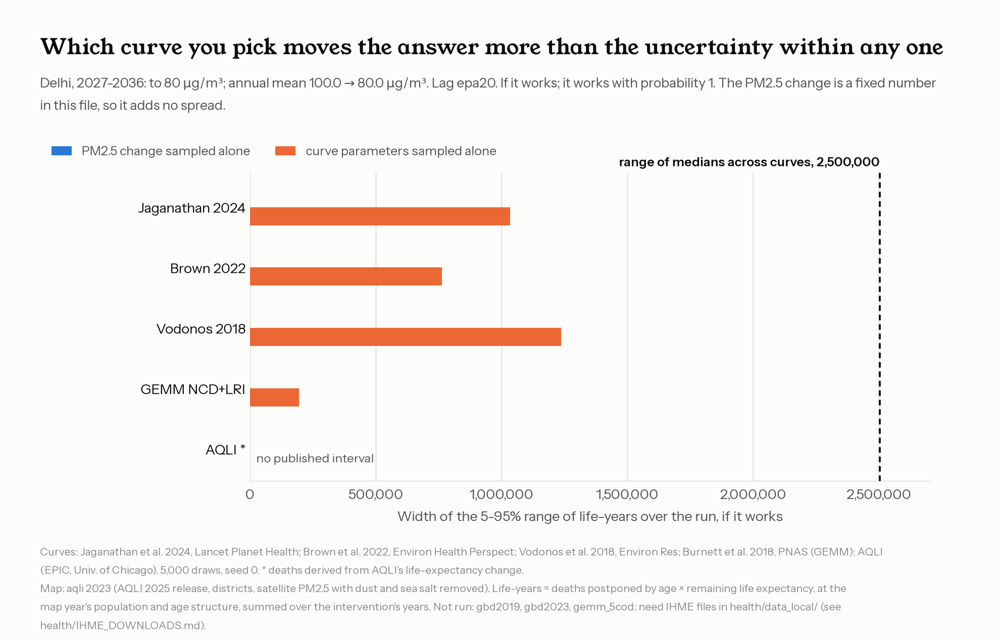

# airhealth: what cleaner air would buy India, and why the answers disagree

`airhealth` takes a change in the air an Indian place breathes and says how many deaths it
would postpone, how many years of life it would add, and how much those cost if the change
has a price. It runs from the terminal, and every number it prints names the assumptions it
rests on.

The published answers to "how many people does India's air kill?" differ several-fold. The
differences come from a few choices that are rarely shown side by side: which **risk curve**
turns pollution into deaths, which **exposure map** says how polluted each place is, and how
time and money are counted. This tool makes those choices visible instead of hiding them
inside one number.

The question it was built for: Delhi breathes about 100 µg/m³. What if that fell to 80?

```
$ airhealth compare Delhi --from 100 --to 80
Delhi (state): PM2.5 100 → 80 µg/m³
Population 21.5 M; all-cause deaths 131,067 a year. Steady state, per year.

curve                  PM2.5 µg/m³  % of deaths  deaths/yr  life exp. yrs  life-years/yr
--------------------  ------------  -----------  ---------  -------------  -------------
loglinear_jaganathan  100.0 → 80.0        15.2%     19,936          +2.25        404,259
loglinear_brown       100.0 → 80.0         1.9%      2,478          +0.24         44,813
loglinear_vodonos     100.0 → 80.0        14.1%     18,509          +1.97        317,348
gemm_ncd_lri          100.0 → 80.0         4.2%      5,453          +0.53         94,498
aqli *                100.0 → 80.0        13.4%     17,569          +1.96        356,259
...
```

Same city, same change, same population and death rates: between 2,500 and 20,000 deaths a
year, and between a quarter of a year and two and a quarter years of life expectancy,
depending only on the curve. No study has followed people who breathe air this dirty for
years, so every curve is being stretched past its evidence here; the tool shows how far
apart the stretches land rather than picking one.

**A few terms, defined once.**
**PM2.5** is the mass of fine particles (smaller than 2.5 thousandths of a millimetre) in a
cubic metre of air, in micrograms (**µg/m³**). Every number here is an **annual mean**: the
average over a whole year, which is what the long-term studies measure. A
**population-weighted** mean counts each district by how many people live in it.
A **risk curve** says how much the death rate rises at a given PM2.5 level, as a **relative
risk** (1.15 means 15% more deaths than in clean air). Each curve has a **floor**, the level
below which it assumes no further benefit (2 to 5 µg/m³ here). An **exposure map** gives
PM2.5 and population for each district, state or city. **Steady state** means the effect
once the new air has been breathed long enough for the full benefit, at today's population
and age structure. **Life expectancy** is the average age at death if today's death rates
held for a lifetime. **Life-years** are the extra years lived: here, each death postponed
times the years a person of that age would still expect to live.

## Install

```
cd air-apocalypse
python3 -m venv .venv
.venv/bin/pip install -e "health[dev]"
cd health
../.venv/bin/python -m pytest -q
../.venv/bin/airhealth --help
```

Python 3.11 or newer. Everything the commands need is committed under `data/`, with its
source, page and method in `data/sources.toml`. A value that could not be confirmed at its
source is left out and listed in `data/MISSING.md`.

## The commands

Add `--json` to any command for the same content as JSON. Every table ends with one line
naming the exposure map and its year, the states that had to borrow all-India death rates,
and the curves that could not run, with why.

### `list`: what the tool knows, each with its source

```
$ airhealth list curves
loglinear_jaganathan  [yes]
  Log-linear, Jaganathan 2024 (Indian districts, all-cause, all ages)
  Source: Jaganathan S, Stafoggia M, Rajiva A, et al. Estimating the effect of annual PM2.5 exposure on mortality in India: a difference-in-differences approach. Lancet Planet Health 2024; 8: e987-96. doi:10.1016/S2542-5196(24)00248-1. https://pmc.ncbi.nlm.nih.gov/articles/PMC11790315/

loglinear_brown  [yes]
  Log-linear, Brown 2022 Million Death Study (non-accidental; studied at ages 15-69, applied from 15, extrapolated above 69)
  Source: Brown PE, Izawa Y, Balakrishnan K, et al. Mortality associated with ambient PM2.5 exposure in India: results from the Million Death Study. Environ Health Perspect 2022; 130(9): 097004. doi:10.1289/EHP9538. https://pmc.ncbi.nlm.nih.gov/articles/PMC9472672/
...
```

`list maps` and `list places` work the same way. Places are India, its states and union
territories, its districts, and eleven cities; any common spelling is accepted ("Orissa",
"NCT of Delhi"), and a misspelling gets suggestions.

### `compare`: one place, one change, every curve

Shown above. `--from` sets the starting level for every district (the map then supplies
only the population); without it, the start is the map's own level for the place, and
`--to` is the new level.

### `burden`: how many deaths the air above clean causes now

```
$ airhealth burden India
India (country): deaths attributable to PM2.5 above each curve's own floor
Population 1,390.3 M; all-cause deaths 10,768,028 a year. Steady state, per year.

curve                 PM2.5 µg/m³  % of deaths  deaths/yr  life exp. yrs  life-years/yr
--------------------  -----------  -----------  ---------  -------------  -------------
loglinear_jaganathan   41.2 → 5.0        24.7%  2,662,992          +4.57     60,550,064
loglinear_brown        41.2 → 2.0         3.4%    367,530          +0.49      6,734,654
loglinear_vodonos      41.2 → 5.0        21.7%  2,340,847          +3.71     40,398,023
gemm_ncd_lri           41.2 → 2.4        16.6%  1,790,764          +2.59     30,995,026
aqli *                 41.2 → 5.0        20.0%  2,154,370          +3.55     48,835,086

  loglinear_jaganathan: Log-linear, Jaganathan 2024 (Indian districts, all-cause, all ages)
  loglinear_brown: Log-linear, Brown 2022 Million Death Study (non-accidental; studied at ages 15-69, applied from 15, extrapolated above 69)
  loglinear_vodonos: Log-linear, Vodonos 2018 meta-regression, all-cause slope at a study mean of 30 µg/m³ (the published slope falls with concentration; one slope misstates it)
  gemm_ncd_lri: GEMM NCD+LRI (Burnett 2018), age-specific
  aqli: AQLI linear, 0.98 years of life expectancy per 10 µg/m³
  * deaths derived from the life-expectancy change, not a relative risk

Map: aqli 2023 (AQLI 2025 release, districts, satellite PM2.5 with dust and sea salt removed). All-India death rates used for Andaman & Nicobar Islands, Arunachal Pradesh, Chandigarh, Dadra & Nagar Haveli, Daman & Diu, Goa, Ladakh, Lakshadweep, Manipur, Meghalaya, Mizoram, Nagaland, Puducherry, Sikkim, Tripura (no SRS life table). Not run: gbd2019, gbd2023, gemm_5cod: need IHME files in health/data_local/ (see health/IHME_DOWNLOADS.md).
```

AQLI gives a change in life expectancy, not a relative risk. To put it in the same table,
the tool finds the single multiplier on death rates that produces AQLI's change and reports
the deaths that implies; the star marks those as derived. This is the command the
benchmarks below use. `--counterfactual C` measures against C µg/m³ instead of each curve's
floor.

### `chart`: the curves, with places marked

```
$ airhealth chart Delhi India
/Users/ask/git/gitcat/indian_health/air-apocalypse/health/charts/curves_delhi.png
```


The shaded band starts at 84 µg/m³, the highest long-term exposure in any group of people
behind the GEMM curve. Everything to its right is extrapolation.

### `run`: an intervention, with odds, cost and uncertainty

An intervention is a short text file (next section). `run` draws 5,000 versions of it: each
draw takes one value of the PM2.5 change (when the file gives a range), one set of curve
parameters from the published uncertainty, and one value of each cost. This is a **Monte
Carlo** simulation; the **5-95% range** is the span holding the middle 90% of draws. Which
curve and which map are never drawn: each curve is its own row, and a run uses one map.

```
$ airhealth run interventions/november_only_delhi.toml
November-only cut in Delhi
Delhi (state). 2027-2036: 10 years, no ramp, lag epa20; these deliver 7.0 years of the full effect. Probability it works: 50%.
Change: monthly delta: Nov -40 µg/m³; other months 0; annual-mean change -3.29 µg/m³ (PM2.5 88.3 → 85.1, population-weighted; median draw).
Population 21.5 M; all-cause deaths 131,067 a year. 5,000 draws, seed 0.

If it works, totals over the run (median, 5-95% range):
curve                                   life-years           deaths postponed  life exp. at full effect, yrs
--------------------  ----------------------------  -------------------------  -----------------------------
loglinear_jaganathan  495,000 (397,000 to 592,000)  24,400 (19,600 to 29,200)         +0.36 (+0.29 to +0.44)
loglinear_brown        51,200 (-13,400 to 114,000)      2,830 (-740 to 6,320)         +0.04 (-0.01 to +0.09)
loglinear_vodonos     390,000 (270,000 to 503,000)  22,700 (15,700 to 29,300)         +0.32 (+0.22 to +0.41)
gemm_ncd_lri           115,000 (98,000 to 133,000)     6,650 (5,650 to 7,680)         +0.09 (+0.08 to +0.11)
aqli *                438,000 (438,000 to 438,000)  21,600 (21,600 to 21,600)         +0.32 (+0.32 to +0.32)

Expected = mean if it works × probability it works (0.5). Cost if it works: $18.2 M ($5.78 M to $61.6 M), 2025 prices, ₹87.16 per $ (World Bank 2025 average), no inflation adjustment; all of it spent whether or not it works.
curve                 expected life-years  cost per life-year if it works  expected cost per expected life-year
--------------------  -------------------  ------------------------------  ------------------------------------
loglinear_jaganathan              247,000                           $47.8                                 $95.7
loglinear_brown                    25,600                            $462                                  $924
loglinear_vodonos                 194,000                           $61.0                                  $122
gemm_ncd_lri                       57,700                            $205                                  $410
aqli *                            219,000                           $53.9                                  $108
  (costs per life-year are ratios of means over the draws)

What drives the spread in life-years within each curve (share of variance, each part sampled alone):
curve                 PM2.5 change       curve parameters
--------------------  ------------  ---------------------
loglinear_jaganathan            0%                   100%
loglinear_brown                 0%                   100%
loglinear_vodonos               0%                   100%
gemm_ncd_lri                    0%                   100%
aqli *                          0%  no published interval
Across curves, the largest median life-years is 9.7× the smallest.

  loglinear_jaganathan: Log-linear, Jaganathan 2024 (Indian districts, all-cause, all ages)
  loglinear_brown: Log-linear, Brown 2022 Million Death Study (non-accidental; studied at ages 15-69, applied from 15, extrapolated above 69)
  loglinear_vodonos: Log-linear, Vodonos 2018 meta-regression, all-cause slope at a study mean of 30 µg/m³ (the published slope falls with concentration; one slope misstates it)
  gemm_ncd_lri: GEMM NCD+LRI (Burnett 2018), age-specific
  aqli: AQLI linear, 0.98 years of life expectancy per 10 µg/m³
  * deaths derived from the life-expectancy change, not a relative risk

Map: aqli 2023 (AQLI 2025 release, districts, satellite PM2.5 with dust and sea salt removed). Life-years = deaths postponed by age × remaining life expectancy, at the map year's population and age structure, summed over the intervention's years. Not run: gbd2019, gbd2023, gemm_5cod: need IHME files in health/data_local/ (see health/IHME_DOWNLOADS.md).
```

How to read it:

- **A November-only cut is small on the annual mean.** Forty µg/m³ off November alone is
  40 × 30/365 = 3.3 µg/m³ off the year, and long-term health follows the year. The sky
  changes a lot for a month; the death rate barely moves.
- **"If it works" and "expected" are kept apart.** The first table assumes the intervention
  succeeds. The probability of success is never drawn at random; it multiplies the mean to
  give the expected life-years.
- **Two cost figures.** *Cost per life-year if it works* is mean cost over mean life-years,
  given success. *Expected cost per expected life-year* charges the cost that is spent
  whether or not it works against the life-years you can expect. By default the whole cost
  is spent either way, so the second is the first divided by the probability. Rupees become
  dollars at the World Bank's annual average rate for the file's price year
  (`data/fx_inr_usd.csv`, 2000-2025). There is **no inflation adjustment**: a 2015-price
  file is reported in 2015 dollars.
- **What drives the spread.** Each part is sampled alone with the other held at its median,
  and its share of the variance is shown. In this file the PM2.5 change is a fixed number,
  so all of the spread within a curve comes from the curve's own published uncertainty.
  AQLI publishes no interval for its coefficient, so its row has none: that is a gap in
  the evidence, not certainty. Brown 2022's interval reaches a relative risk of 1.00, so
  some of its draws find no benefit at all.
- **Across curves** the medians differ almost tenfold, far more than any curve's own range.

`--charts DIR` also draws two charts:




Other flags: `--map M` (default: cpcb when every place is a city with ground monitors,
otherwise aqli), `--curves a,b`, `--n N` draws, `--seed S` (the same seed gives the same
answer).

**How time is counted in this version.** The steady-state effect is computed once per
draw. Each year of the intervention then realises a share of it. The **ramp** brings the
change in over `ramp_years` in equal steps. The **cessation lag** is how slowly the death
rate follows the air down: by default the US EPA's 20-year lag (30% of the fall in risk in
the first year, 50% spread over years 2-5, 20% over years 6-20); `immediate` puts it all in
year one. Each step of the ramp starts its own lag clock. Deaths postponed and life-years
are the steady-state figures times the sum of those yearly shares. Years after the
intervention ends count for nothing, nothing is discounted, and life-years are deaths
postponed × remaining life expectancy at the age of death. A year-by-year cohort run to
2050, with the population ageing, replaces this accounting in the next version.

## Writing an intervention file

Copy `interventions/_template.toml`; every field is explained there. A mistake is reported
in one line naming the field, for example `airhealth: p_success: must be between 0 and 1,
got 2`. The shape:

```toml
name = "10% cut in Punjab and Haryana"
places = ["Punjab", "Haryana"]   # India, states, districts or cities; overlaps are refused
start_year = 2027
ramp_years = 3                   # years to reach the full change
duration_years = 15
p_success = 0.3                  # probability it works at all
lag = "epa20"                    # or "immediate"
# from_level = 100               # what-if: start every district at this level

[change]                         # exactly one of these
pct = -10                        # delta = -20 | pct = -10 | to = 40 |
                                 # monthly_delta = [12 values] | monthly_pct = [12 values]

[cost]
once = { dist = "lognormal", p5 = 5e9, p95 = 5e10 }
annual = { dist = "lognormal", p5 = 1e9, p95 = 1e10 }
currency = "INR"                 # or "USD"
year = 2025                      # price year; rupees converted at that year's average rate
share_only_on_success = 0.0      # share of the cost spent only if it works
```

Any number in `[change]` or `[cost]` can be a range instead: give its 5th and 95th
percentiles and a shape, `normal`, `lognormal` (skewed, never crossing zero), `uniform`, or
`triangular` (with a `mode`). Twelve monthly values are averaged by days in the month; when
they are ranges they are drawn together, so a draw that is good for November is good for
December too. A drawn change never takes the air below 0 µg/m³.

The three examples: `delhi_100_to_80.toml` (the what-if above, no cost or odds),
`november_only_delhi.toml`, and `punjab_haryana_10pct.toml`. Their odds and costs are
illustrative placeholders, said so in each file's notes, and should not be quoted.

## The exposure maps, and how much they disagree

Where a place starts on the curve matters as much as the curve, and the maps disagree
twofold. Population-weighted annual-mean PM2.5 in µg/m³, from this tool:

| Place | `aqli` 2023 | `aqli` 2019 | `acag_total` 2023 | `gbd2019` 2019 |
|---|---:|---:|---:|---:|
| India | 41.2 | 44.6 | 49.8 | 90.9 |
| Delhi | 88.3 | 92.7 | 98.8 | 217.6 |
| Uttar Pradesh | 56.2 | 64.8 | 68.2 | 182.9 |
| Bihar | 60.1 | 68.6 | 64.0 | 167.8 |
| Kerala | 18.5 | 17.1 | 26.1 | 15.8 |

Delhi's own ground monitors (`cpcb`, the city, mean of hourly medians across stations): 104.7
in 2019, 97.5 in 2023, 94.3 in 2025.

- `aqli`: the Air Quality Life Index's district table, from satellites, with dust and sea
  salt removed (the index counts only the pollution people make).
- `acag_total`: the same satellite family (Washington University's ACAG V6) with dust kept,
  averaged to districts by this repo.
- `gbd2019`: the Global Burden of Disease 2019 state values, as printed in Pandey et al. 2021
  (a model fusing satellites, chemistry models and monitors). One value per state.
- `cpcb`: the Central Pollution Control Board's monitors, for eleven cities only.

Keeping dust moves India from 41 to 50: dust explains under a fifth of the gap to GBD's 91.
The rest is concentrated in the northern plain (Uttar Pradesh 56 against 183); in Kerala
the three maps land within 16 to 26. In Delhi the monitors side with the satellites, not with GBD 2019. Why GBD
2019 sits so high is an open question; see G7 in [`../lit/gaps.md`](../lit/gaps.md).

## Benchmarks: does it reproduce published numbers?

`python benchmarks/run.py` runs each published estimate's curve, counterfactual and year on
the closest map, and writes [`benchmarks/README.md`](benchmarks/README.md) with a paragraph
on every gap. Nothing is tuned to close one.

| Case | Measures | Published | Ours | Ratio | Tolerance |
|---|---|---|---|---|---|
| jaganathan2024_share | share | 24.9% of deaths | 25.7% of deaths | 1.032 | ±15% |
| jaganathan2024_deaths | deaths | 1.50 M deaths/yr | 2.10 M deaths/yr | 1.402 | ±50% |
| aqli2025_india_years | years | 3.50 years | 3.55 years | 1.014 | ±5% |
| aqli2025_delhi_years | years | 8.20 years | 8.17 years | 0.996 | ±5% |
| burnett2018_india_maps | deaths | 2.22 M deaths/yr | 1.42 M deaths/yr | 0.642 | ±40% |
| burnett2018_india_forced74 | deaths | 2.22 M deaths/yr | 1.98 M deaths/yr | 0.892 | ±15% |

In short: the shares and life-expectancy gains match; counts differ where the paper counted
a different set of deaths (Jaganathan used registered deaths only, which miss many) or used
a dirtier map (Burnett's GEMM paper put India at 74 µg/m³ against AQLI's 45 for 2015).

## Known limitations

- **State death rates are applied to every district and city in the state.** A district
  poorer or richer than its state's average is placed wrongly.
- **15 small states and territories use all-India death rates**: Andaman & Nicobar,
  Arunachal Pradesh, Chandigarh, Dadra & Nagar Haveli, Daman & Diu, Goa, Ladakh,
  Lakshadweep, Manipur, Meghalaya, Mizoram, Nagaland, Puducherry, Sikkim and Tripura have
  no life table of their own in the Sample Registration System (SRS). Tables say so.
- **Death rates are the SRS 2020-24 tables, applied to every year.** A 2014 benchmark uses
  2020-24 death rates with 2014's population.
- **City populations are the 2011 Census**, the same in every year; districts and states use
  the official projections for the map year.
- **The 80+ population is split into 80-84 and 85+** in the proportions of the life table's
  stationary population, which overstates the oldest group; the effect is an estimated 1-2%
  of deaths.
- **Ambient air only.** Smoke from cooking fires is not counted; in states where many homes
  burn solid fuel, people are placed lower on the curve than they really are.
- **The cause-of-death shares are thin.** GEMM covers only non-communicable disease and
  lower respiratory infection; their share of deaths is all-India, by broad age group, from
  the SRS Causes of Death 2021-23 report (a verbal-autopsy survey with no state breakdown),
  not from the Million Death Study, whose fieldwork ended in 2013.
- **Above about 84 µg/m³ every curve is an extrapolation.** No long-term study has observed
  people at those levels. The tool shows how far apart the curves land; it does not resolve
  it.
- **Life-years are deaths postponed × remaining life expectancy**, at the map year's
  population and age structure, within the intervention's years, undiscounted. A cohort run
  to 2050 replaces this; when it comes, the population after 2036 (the end of the official
  projections) will be a crude extension.
- **The uncertainty is partial.** Ranges cover the PM2.5 change, the curve's own published
  uncertainty and the cost. They do not cover the choice of curve or map (shown as separate
  results instead), the death rates, or the population. AQLI has no published interval.
- **Costs are converted at one annual exchange rate and not adjusted for inflation.**

## Not built yet

- **IHME-tier curves** (GBD 2019 and 2023, GEMM five causes). They need files IHME will not
  let us redistribute; [`IHME_DOWNLOADS.md`](IHME_DOWNLOADS.md) says what to download and
  where to put it. Today the tool names them as unavailable.
- **The run to 2050**: a year-by-year cohort simulation with an ageing population, which
  separates the ageing effect from the intervention's.
- **Valuation presets**: putting money values on deaths and life-years (value of a
  statistical life, lost output, multiples of income per head). Only cost per life-year is
  reported now.
- **The Surat case**: reproducing Greenstone et al.'s "benefits at least 25× costs" for
  Surat's emissions trading scheme.
- **A web page.** The JSON output (`--json`) is the intended interface for one.

## Layout

```
airhealth/        the package: places, exposure, baseline, lifetable, curves, impact,
                  intervention, lag, simulate, report, charts, cli
data/             committed tables, each with an entry in data/sources.toml; MISSING.md
data_local/       IHME files, never committed (git-ignored)
interventions/    the template and three examples
benchmarks/       cases.toml, run.py, README.md (generated)
charts/           charts drawn by the commands above
scripts/          the scripts that build data/ from the sources
tests/            pytest
```
